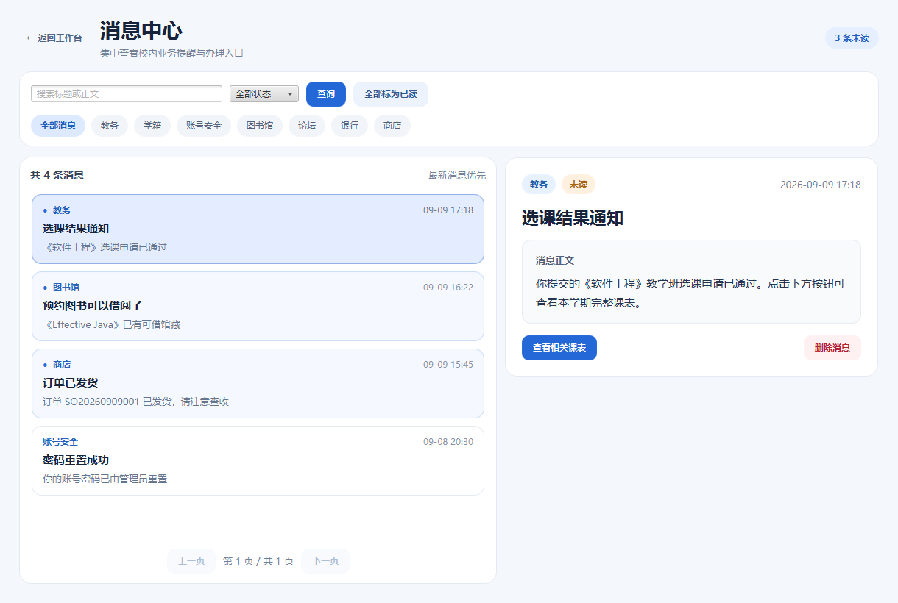
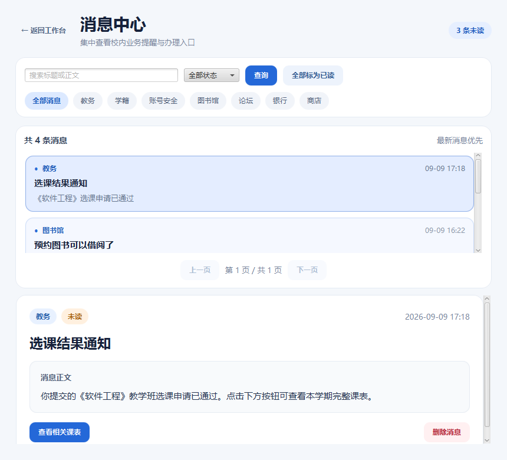

# 消息中心 JavaFX 设计检查

## 页面结构

- 宽屏采用左侧消息列表、右侧常驻详情栏，检索条件和来源筛选集中放在顶部工具区；
- 内容宽度小于 980px 时切换为上下布局，列表和详情都保留独立滚动区域；
- 未读消息使用蓝点与浅蓝卡片，选中卡片加深边框和背景，标题、摘要、来源和时间保持深色文字；
- 用户点击消息后才读取详情并标记已读，进入页面时不会自动消费第一条未读消息；
- 详情底部提供独立的红色“删除消息”按钮；确认删除后清空详情并刷新列表和未读数，取消确认不产生请求；
- 详情中的按钮按受控枚举跳转到原生教务、学籍、图书馆、论坛、银行或商店页面，不执行服务端传入的网址或路径。

## 响应式截图

宽屏 1220×820：

窄屏 860×780：

## 自动化检查

- `NotificationViewTest`：未读卡片、来源标签、常驻详情、业务按钮和窄屏上下布局；
- `NotificationControllerTest`：进入页面不自动标已读、点击标已读、一键已读、删除后的列表与角标同步、筛选分页参数及旧请求隔离；
- `SocketNotificationGatewayTest`：现有 Socket API 的参数转发、响应解析与修改结果校验；
- `NotificationCampusIntegrationTest`：各类通知到原生业务页面的安全路由映射；
- `NotificationScreenshotTest`：生成并验证宽屏和窄屏页面截图。

消息中心使用 `notification.search`、`notification.get`、`notification.unreadCount`、`notification.markRead`、`notification.markAllRead` 和 `notification.delete`。删除只写入当前用户所属消息的 `deleted_at`，不物理删除业务记录。
